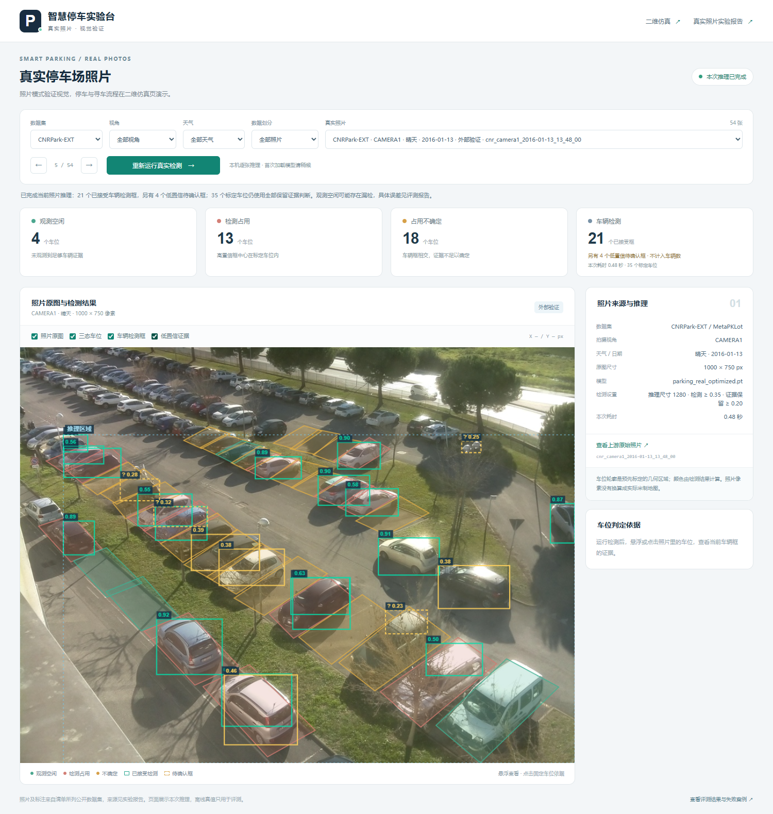

# 智慧停车仿真系统

本项目包含两个可运行页面：**真实停车场照片检测**展示实拍照片上的 YOLO 与三态占用；**52 车位二维仿真**展示约束选位、A* 路线、实际停车确认和反向寻车。胡轩铭负责的场景、感知、会话和交互模块已在这里；规则与寻路随附可替换的参考实现，供梁可按固定接口接入自己的代码。

**第一次来看：** [梁可从这里开始](docs/梁可从这里开始.md) · [Windows 演示包下载入口](https://github.com/Cancery980/smart-parking-sim-real/releases/latest/download/ParkingDemo-Windows.zip) · [接口约定](docs/CONTRACT_V1.md)

**课堂展示：** [七分钟演示与答辩](docs/课堂演示与答辩.md) · [实拍优化与外部验证报告](reports/real_optimization/RESULTS.md) · [评分点与证据](docs/评分点与证据.md)

> **v1.2 交付内容：** 本地 Windows EXE 的 13 项实拍界面检查与 6 项停车流程检查已通过，包含实际 CPU 推理；这说明程序流程可运行，不代表模型对外部场景准确。下载入口沿用 latest，具体已上传版本以 [Releases](https://github.com/Cancery980/smart-parking-sim-real/releases) 为准。完整解压后双击 ParkingDemo.exe，不需要先安装 Python。

当前源码的实拍清单有 **108 张：18 张 PKLot 开发照片、36 张 PKLot 历史测试照片、54 张 CNRPark-EXT 外部验证照片**。PKLot 来自两个场地、三个视角及三种天气，历史测试覆盖 32 个日期；CNR 来自另一场地，覆盖 9 台相机、20 个日期及三种天气。旧 36 张已经公开分析，本轮用作历史回归；外部 54 张未参与训练、模型选型或阈值选择。点击来源可查看上游原图，点击检测按钮会在本机重新推理。[数据来源与划分](docs/REAL_DATA_SOURCES.md) · [浏览器版实拍报告](reports/real_photo_report.html)。

本轮在 PKLot 历史场景上改善了车辆检测，但 **CNR 外部召回率和 F1 下降，假空闲增加**，不能称为全面提升：

| 实拍数据 | v1.1 默认精确率 / 召回率（门槛0.20） | v1.2 精确率 / 召回率（门槛0.35） | 假空闲次数 |
| --- | --- | --- | --- |
| PKLot 历史36张 | 96.56% / 98.80% | 98.48% / 98.89% | 0 → 1 |
| CNR 外部54张 | 76.72% / 71.78% | 88.06% / 61.67% | 154 → 243 |

共同0.20门槛下，新模型在CNR仍为84.09%精确率、64.46%召回率，召回低于原模型；外部退步不能全部归因于抬高检测门槛。完整分母、三项对照与失败案例见[实测报告](reports/real_optimization/RESULTS.md)。[v1.1.0 基线发布](https://github.com/Cancery980/smart-parking-sim-real/releases/tag/v1.1.0)和[v1.1 PKLot运行画面](reports/real_photo_final_ui.png)保留用于比较。

下面是本次 EXE 中实际运行的外部照片页面：



二维仿真页保留完整停车流程，包含模型检测框、实际停车位和人行寻车路线。[查看完整界面](reports/ui_full.png)。


## 先看演示

1. 下载 [ParkingDemo-Windows.zip](https://github.com/Cancery980/smart-parking-sim-real/releases/latest/download/ParkingDemo-Windows.zip)，将整个压缩包解压到一个文件夹。
2. 双击解压目录内的 **ParkingDemo.exe**。保留同目录的文件和子目录，不要只单独复制 exe。
3. 等待本地模型加载，浏览器会自动打开真实照片页 `http://127.0.0.1:8766/real`。
4. 使用期间保留启动窗口；关闭窗口即停止程序。会话保存在内存中，退出后不保留。

**先看真实照片：** v1.2 页面可按数据集、视角、天气和数据划分选图；选择 CNRPark-EXT 的“外部验证”，点击“运行真实 YOLO 检测”。切换原图、车辆框与三态图层，点击车位查看本次框的置信度、中心位置和相交比例。换照片后旧结果会清空，需要重新检测。源码版可从首页的“真实停车场照片”进入。若下载的是 v1.1 基线包，其照片清单和控件保持旧版。

**车辆检测与占用证据分开：** 车辆数字只计达到开发集选定检测门槛的“已接受框”，门槛显示在侧栏，误检仍以离线评测核对。低于该门槛但置信度不低于 **0.20** 的框列为“低置信待确认”，可勾选对应图层查看虚线框；它们仍参与车位三态判断。占用规则保留全部 ≥0.20 的证据，高置信占用门槛为 0.50、相交比例为 5%；隐藏图层不会删除证据或把这些车位改为空闲。

浅蓝细虚线标出模型实际推理区域。车位未被完整覆盖且缺少明确车辆证据时，保留为 `unknown`；已有高置信框中心证据仍可判为占用。详情中的覆盖比例表示车位面积进入推理区域的比例，不是识别正确率，照片尺寸也没有变成裁剪区域尺寸。

免安装演示包包含 Python 运行环境和模型，使用 CPU 推理，不要求先安装 Python 或配置显卡。**GitHub 网页负责展示代码和提供下载；它本身不运行这套 Python 程序。** 浏览器里的 `127.0.0.1` 指向你自己的电脑，检测也在本机执行。

**再看停车流程：** 返回“二维仿真”，选择车辆、需求与偏好并申请车位，再确认实际停入的位置，最后从人行通道点选起点寻车。实际停车可以不同于推荐；更换场景会使旧路线失效，已确认的停车记录保留。离场移除当前车辆，重置恢复初始场景。真实照片页按原始像素和标定车位多边形验证视觉，没有把照片坐标直接当作实际米制路网。

悬浮或点击车位可查看当前检测框的置信度、中心归属和相交比例，现场解释三态判断。[查看证据详情实景](reports/ui_evidence.png)；数值核对及交互检查见 [新增界面验收](reports/ui_evidence_validation.json)。

## 胡轩铭和梁可怎样拼在一起

| 部分 | 负责内容与接口 |
| --- | --- |
| 胡轩铭模块 | 场景与数据、YOLO、三态占用、视觉评测、本地界面、会话、实际停车确认与起点交互 |
| 梁可规划模块 | 资格与需求规则、双模式选位、车行/人行 A*、起点投影与路径校验，按同一接口参与联调和配对实验 |
| 接线位置 | 无参 `Planner` 类，实现 `plan(context, request)` 和 `find_vehicle(context, request)` |
| 随包参考实现 | [reference_planner.py](parking_hu/reference_planner.py)，保证当前项目能演示完整流程；它不是梁可已提交的代码，可替换 |

先读 [梁可从这里开始](docs/梁可从这里开始.md)，再看 [详细交接说明](docs/PLANNER_HANDOFF.md) 和 [完整字段约定](docs/CONTRACT_V1.md)。胡模块传入统一地图、同一帧感知快照、登记车辆及会话摘要；规划模块返回普通 Python 字典，不需要重写界面或检测器。

## 下载源码并运行

要改规划代码，使用源码版。GitHub 页面点 **Code → Download ZIP**，解压后进入含 `README.md`、`setup.ps1` 和 `parking_hu` 的目录；不需要先学 Git。

安装 **Python 3.12** 并让 `python` 命令可用，在该目录打开 PowerShell，执行：

```powershell
powershell -ExecutionPolicy Bypass -File .\setup.ps1
powershell -ExecutionPolicy Bypass -File .\start.ps1
```

安装脚本创建项目内的 `.venv`，依赖安装需要网络。安装完成后也可双击 [启动项目.cmd](启动项目.cmd)。源码版默认打开 `http://127.0.0.1:8765`，正常演示不需要在线模型账号。

如果电脑有多个 Python，给 `setup.ps1` 加 `-Python "C:\Python312\python.exe"`，其中路径须换成实际的 Python 3.12 路径。默认安装 CPU 版 PyTorch；已配置兼容 NVIDIA/CUDA 12.4 环境时，可加 `-Cuda`。

## 接入梁可模块

[examples/liang_adapter.py](examples/liang_adapter.py) 已给出接线样例，目前委托给随包参考实现。先保持原样运行检查，再把样例内部调用替换为梁可自己的计算逻辑：

```powershell
.\.venv\Scripts\python.exe scripts/check_plugin.py --planner examples.liang_adapter:Planner
powershell -ExecutionPolicy Bypass -File .\start.ps1 -Planner examples.liang_adapter:Planner
```

如果另写项目根目录下的 `liang_planner.py`，使用 `liang_planner:Planner` 替换上述参数即可。也可直接启动：

```powershell
.\.venv\Scripts\python.exe -m parking_hu --planner liang_planner:Planner
```

规划输入不含真值空位。成功推荐必须返回入场、出场和到电梯三条合法路线；路径保留经过的图节点。主模块会检查返回结构与路线，拒绝不合法结果。

## 测试与报告

在源码根目录、完成依赖安装后执行：

```powershell
.\.venv\Scripts\python.exe -m pytest tests -q
.\.venv\Scripts\python.exe scripts/check_plugin.py --planner examples.liang_adapter:Planner
.\.venv\Scripts\python.exe scripts/run_e2e.py
.\.venv\Scripts\python.exe scripts/run_pairing.py
.\.venv\Scripts\python.exe scripts/compare_modes.py
```

确定性测试使用固定检测数据检查规则；`check_plugin.py --planner ...` 检查指定插件的契约。`run_e2e.py` 调用真实 YOLO 验证 E01—E08，可通过 `--planner` 接入自己的规划模块。未指定时使用随包参考实现。若已创建 `liang_planner.py`，运行：

```powershell
.\.venv\Scripts\python.exe scripts/run_e2e.py --planner liang_planner:Planner --out reports/e2e_liang
```

结果和场景证据另存到 `reports/e2e_liang`，保留原有默认验收记录。要先检验随包外部接线样例，可使用 `--planner examples.liang_adapter:Planner --out reports/e2e_external`。契约检查、真实端到端和性能评测分别记录；配对实验用 `run_pairing.py --planner examples.liang_adapter:Planner` 指定适配器。

实际记录见 [UI 验收](reports/ui_validation.json)、[端到端验收](reports/e2e/results.json)、[视觉评测](reports/vision_report.md)、[二态与三态对照](reports/i01_pairing/RESULTS.md)、[双模式与入口基线](reports/mode_comparison/RESULTS.md) 和 [实验报告](reports/胡轩铭模块实现与验证报告.docx)。入口基线脚本比较随包参考适配器的共享候选排序；梁可接入后须按同一协议核对其实现。重跑评测会写入相应结果文件，需要保留原记录时先复制备份。

实拍优化的固定入口是 [新结果与失败案例](reports/real_optimization/RESULTS.md)、[冻结选择](reports/real_optimization/frozen_selection.json)、[最终实测 JSON](reports/real_optimization/final/summary.json) 和 [浏览器版报告](reports/real_photo_report.html)。结果分别列出历史回归与 CNR 外部验证，并同时比较各配置的检测门槛和共同 0.20 门槛，区分门槛调整与模型变化。三态混淆、不确定数、覆盖率与假空闲单独报告，车辆框和车位标签各用各的真值。

本次 [EXE 实拍界面13项验收](reports/real_photo_portable_validation.json)与[EXE 停车流程6项验收](reports/windows_optimized_flow_validation.json)均已通过；前者有6个视角的实际CPU推理、照片切换/重复推理、天气筛选、证据图层及390px布局检查，0个浏览器脚本错误。CAMERA5样例出现零检测属于保留的模型失败表现，不能因程序正常执行就算识别正确。[功能测试 XML](reports/real_optimization/functional_tests.xml)属于另一类规则检查。

[v1.1 实拍报告](reports/real_photos/RESULTS.md)与[v1.1 照片页交互验收](reports/real_photo_ui_validation.json)继续作为历史记录。[完整课程报告 PDF](reports/胡轩铭模块实现与验证报告.pdf)和[Word报告](reports/胡轩铭模块实现与验证报告.docx)汇总合成与实拍实验，并分别说明范围。

| 目录 | 内容 |
| --- | --- |
| [parking_hu/](parking_hu/) | 地图、场景、检测、占用、会话、契约与参考规划 |
| [static/](static/) | 本机浏览器界面 |
| [examples/](examples/) | 梁可接线样例、输入输出示例 |
| [models/](models/) | 模型权重与来源 |
| [data/](data/) | 合成数据、实拍照片、冻结划分、独立标注和模型检测缓存 |
| [scripts/](scripts/) | 数据、训练、评测和插件检查工具 |
| [docs/](docs/) | 新手操作、接口、交接与论文说明 |
| [reports/](reports/) | 实际运行记录、截图、指标和报告 |

## 实验范围

- **二维仿真实验：** 使用固定 52 车位地图和程序生成的车辆图形。留出场景用于检测、停车流程、二态/三态配对与路线比较；这些成绩属于合成域。
- **真实照片实验：** PKLot 的 18 张开发照片用于选型，已公开的 36 张历史测试用于回归；CNRPark-EXT 的 54 张照片用于另一场地的外部验证。PKLot 训练、开发和历史测试按日期隔离，CNR 外部照片不参与模型或阈值选择。外部结果只覆盖这一场地和采样条件，不能保证任意停车场均有效，也没有验证真实场地 A*、米制标定、定位或车辆控制。

本项目未承诺或证明 **99.99%** 的检测、召回或车位正确率。完全漏检仍可能产生假空位，`unknown` 不保证发现所有漏检。场景真值只用于渲染、标注、确认冲突检查和离线评测，不进入推荐上下文；真实照片运行时只读取原图和车位几何，离线占用标签不参与上色。

自然语言解析、自动定位、视觉身份关联、真实资格认证和车辆控制不属于当前交付。源码、权重及许可证见 [第三方说明](THIRD_PARTY_NOTICES.md)，方法来源见 [论文核对](docs/PAPERS.md)。

需要重新构建 Windows 演示程序时，参见 [Windows 打包说明](docs/WINDOWS_BUILD.md)。[交付核验](reports/交付核验.json)记录具体版本及交付文件，公开下载状态以 Releases 为准。

公开仓库可以浏览和下载。需要在 GitHub 提交改动时，可先 Fork 到自己的账号，再提交 Pull Request 供整合；公开访问不代表可以直接修改本仓库主分支。
