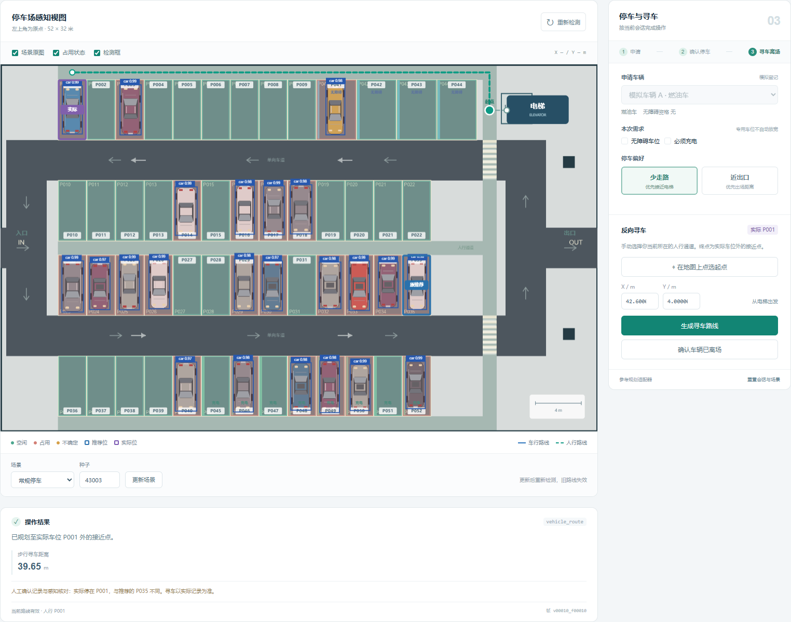

# 智慧停车仿真系统

本项目把 52 个车位的二维场景、真实 YOLO 检测、三态占用、约束选位、A* 路线与实际停车记录串成一个本地演示。胡轩铭负责的场景、感知、会话和交互模块已在这里；规则与寻路随附可替换的参考实现，供梁可按固定接口接入自己的代码。

**第一次来看：** [梁可从这里开始](docs/梁可从这里开始.md) · [Windows 演示包下载入口](https://github.com/Cancery980/smart-parking-sim-real/releases/latest/download/ParkingDemo-Windows.zip) · [接口约定](docs/CONTRACT_V1.md)

> Windows x64 演示包已通过实际启动与停车流程检查。下载后完整解压，双击 ParkingDemo.exe；不需要先安装 Python。

下面是本项目实际运行的界面，包含真实 YOLO 检测框、实际停车位和人行寻车路线。[查看完整界面](reports/ui_full.png)。



## 先看演示

1. 下载 [ParkingDemo-Windows.zip](https://github.com/Cancery980/smart-parking-sim-real/releases/latest/download/ParkingDemo-Windows.zip)，将整个压缩包解压到一个文件夹。
2. 双击解压目录内的 **ParkingDemo.exe**。保留同目录的文件和子目录，不要只单独复制 exe。
3. 等待本地模型加载，浏览器会自动打开。免安装版默认地址为 `http://127.0.0.1:8766`。
4. 使用期间保留启动窗口；关闭窗口即停止程序。会话保存在内存中，退出后不保留。

免安装演示包包含 Python 运行环境和模型，使用 CPU 推理，不要求先安装 Python 或配置显卡。**GitHub 网页负责展示代码和提供下载；它本身不运行这套 Python 程序。** 浏览器里的 `127.0.0.1` 指向你自己的电脑，检测也在本机执行。

演示时先选择车辆、需求与偏好并申请车位，再确认实际停入的位置，最后从人行通道点选起点寻车。实际停车可以不同于推荐；更换场景会使旧路线失效，已确认的停车记录保留。离场移除当前车辆，重置恢复初始场景。

## 胡轩铭和梁可怎样拼在一起

| 部分 | 负责内容与接口 |
| --- | --- |
| 胡轩铭模块 | 场景与数据、YOLO、三态占用、视觉评测、本地界面、会话、实际停车确认与起点交互 |
| 梁可规划模块 | 资格与需求规则、双模式选位、车行/人行 A*、起点投影与路径校验，按同一接口参与联调和配对实验 |
| 接线位置 | 无参 `Planner` 类，实现 `plan(context, request)` 和 `find_vehicle(context, request)` |
| 随包参考实现 | [reference_planner.py](parking_hu/reference_planner.py)，保证当前项目能演示完整流程；它不是梁可已提交的代码，可替换 |

先读 [梁可从这里开始](docs/梁可从这里开始.md)，再看 [详细交接说明](docs/PLANNER_HANDOFF.md) 和 [完整字段约定](docs/CONTRACT_V1.md)。胡模块传入统一地图、同一帧感知快照、登记车辆及会话摘要；规划模块返回普通 Python 字典，不需要重写界面或检测器。

## 下载源码并运行

要改规划代码，使用源码版。GitHub 页面点 **Code → Download ZIP**，解压后进入含 `README.md`、`setup.ps1` 和 `parking_hu` 的目录；不需要先学 Git。

安装 **Python 3.12** 并让 `python` 命令可用，在该目录打开 PowerShell，执行：

```powershell
powershell -ExecutionPolicy Bypass -File .\setup.ps1
powershell -ExecutionPolicy Bypass -File .\start.ps1
```

安装脚本创建项目内的 `.venv`，依赖安装需要网络。安装完成后也可双击 [启动项目.cmd](启动项目.cmd)。源码版默认打开 `http://127.0.0.1:8765`，正常演示不需要在线模型账号。

如果电脑有多个 Python，给 `setup.ps1` 加 `-Python "C:\Python312\python.exe"`，其中路径须换成实际的 Python 3.12 路径。默认安装 CPU 版 PyTorch；已配置兼容 NVIDIA/CUDA 12.4 环境时，可加 `-Cuda`。

## 接入梁可模块

[examples/liang_adapter.py](examples/liang_adapter.py) 已给出接线样例，目前委托给随包参考实现。先保持原样运行检查，再把样例内部调用替换为梁可自己的计算逻辑：

```powershell
.\.venv\Scripts\python.exe scripts/check_plugin.py --planner examples.liang_adapter:Planner
powershell -ExecutionPolicy Bypass -File .\start.ps1 -Planner examples.liang_adapter:Planner
```

如果另写项目根目录下的 `liang_planner.py`，使用 `liang_planner:Planner` 替换上述参数即可。也可直接启动：

```powershell
.\.venv\Scripts\python.exe -m parking_hu --planner liang_planner:Planner
```

规划输入不含真值空位。成功推荐必须返回入场、出场和到电梯三条合法路线；路径保留经过的图节点。主模块会检查返回结构与路线，拒绝不合法结果。

## 测试与报告

在源码根目录、完成依赖安装后执行：

```powershell
.\.venv\Scripts\python.exe -m pytest tests -q
.\.venv\Scripts\python.exe scripts/check_plugin.py --planner examples.liang_adapter:Planner
.\.venv\Scripts\python.exe scripts/run_e2e.py
.\.venv\Scripts\python.exe scripts/run_pairing.py
```

确定性测试使用固定检测数据检查规则；`check_plugin.py --planner ...` 检查指定插件的契约。`run_e2e.py` 调用真实 YOLO 验证 E01—E08，可通过 `--planner` 接入自己的规划模块。未指定时使用随包参考实现。若已创建 `liang_planner.py`，运行：

```powershell
.\.venv\Scripts\python.exe scripts/run_e2e.py --planner liang_planner:Planner --out reports/e2e_liang
```

结果和场景证据另存到 `reports/e2e_liang`，保留原有默认验收记录。要先检验随包外部接线样例，可使用 `--planner examples.liang_adapter:Planner --out reports/e2e_external`。契约检查、真实端到端和性能评测分别记录；配对实验用 `run_pairing.py --planner examples.liang_adapter:Planner` 指定适配器。

实际记录见 [UI 验收](reports/ui_validation.json)、[端到端验收](reports/e2e/results.json)、[视觉评测](reports/vision_report.md)、[二态与三态对照](reports/i01_pairing/RESULTS.md) 和 [实验报告](reports/胡轩铭模块实现与验证报告.docx)。重跑评测会写入相应结果文件，需要保留原记录时先复制备份。

| 目录 | 内容 |
| --- | --- |
| [parking_hu/](parking_hu/) | 地图、场景、检测、占用、会话、契约与参考规划 |
| [static/](static/) | 本机浏览器界面 |
| [examples/](examples/) | 梁可接线样例、输入输出示例 |
| [models/](models/) | 模型权重与来源 |
| [data/](data/) | 合成数据、冻结划分和真实检测缓存 |
| [scripts/](scripts/) | 数据、训练、评测和插件检查工具 |
| [docs/](docs/) | 新手操作、接口、交接与论文说明 |
| [reports/](reports/) | 实际运行记录、截图、指标和报告 |

## 实验范围

车辆图形由程序生成，模型适用于本项目的俯视合成场景。测试使用未参与训练或调参的场景种子，结果不能直接外推为真实停车场照片的准确率。完全漏检仍可能产生假空位，`unknown` 不保证发现所有漏检。场景真值只用于渲染、标注、确认冲突检查和离线评测，不进入推荐上下文。

自然语言解析、自动定位、视觉身份关联、真实资格认证和车辆控制不属于当前交付。源码、权重及许可证见 [第三方说明](THIRD_PARTY_NOTICES.md)，方法来源见 [论文核对](docs/PAPERS.md)。

公开仓库可以浏览和下载。需要在 GitHub 提交改动时，可先 Fork 到自己的账号，再提交 Pull Request 供整合；公开访问不代表可以直接修改本仓库主分支。
