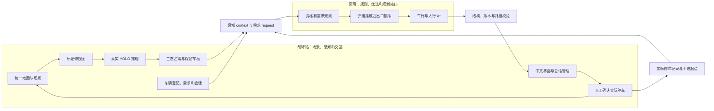

# 评分点与交付证据

本项目按选题表中的功能、创新对照和交付要求组织成果。期末展示的重点是：功能能实际运行，方法能解释，结果能追溯，双方模块能对接。具体成绩由任课教师评分，本页用于核对完成度和安排展示。

## 要让老师检查到什么

| 关注点 | 已有实现或证据 | 核对入口 |
| --- | --- | --- |
| 完整流程 | 申请、重规划、取消、确认实际位置、手选起点寻车、离场、重置；场景更新撤销旧路线 | [演示与答辩](课堂演示与答辩.md)、[浏览器28项检查](../reports/ui_validation.json) |
| 实拍视觉验证 | 54张实拍演示照片：18开发、36测试；测试覆盖32个日期，来源含两个场地、三个视角、三天气；分别评估车辆与占用 | [真实照片结果](../reports/real_photos/RESULTS.md)、[照片页实景](../reports/real_photo_ui.png)、[数据来源](REAL_DATA_SOURCES.md) |
| 真实视觉计算 | 照片按钮实际执行YOLO，并给出置信度、车位相交证据与来源；合成帧也调用模型，输入始终是像素 | [照片页交互验收](../reports/real_photo_ui_validation.json)、[合成训练与测试](../reports/vision_report.md)、[实际E验收](../reports/e2e/results.json) |
| 三态创新有对照 | 同一真实检测缓存、资格、障碍和路网，仅切换占用策略；30景、60个配对请求 | [I01明细与结论](../reports/i01_pairing/RESULTS.md)、[逐请求CSV](../reports/i01_pairing/paired_requests.csv) |
| 硬约束与可解释路线 | 普通/充电/无障碍条件不自动放宽；入场、出场、到电梯均检查可达性；路径距离来自路网 | [接口契约](CONTRACT_V1.md)、[规划交接](PLANNER_HANDOFF.md)、[规则测试](../tests/test_planner.py) |
| 实际停车闭环 | 实际位可与推荐位不同；记录事实后，寻车目标改为实际位外接近点 | [E06/E07记录](../reports/e2e/results.json)、[会话测试](../tests/test_sessions.py) |
| 可以交接和复跑 | JSON兼容的Python接口、外部适配器样例、指定模块的真实模型验收命令 | [梁可从这里开始](梁可从这里开始.md)、[外部模块E验收](../reports/e2e_external/results.json) |
| 工程交付完整 | 源码、固定依赖、原创合成数据、有来源的实拍照片、模型、许可证、报告和Windows演示包 | [项目首页](../README.md)、[总核验](../reports/交付核验.json)、[Windows重建](WINDOWS_BUILD.md) |
| 来源说得清楚 | YOLO调用Ultralytics，A*调用NetworkX，几何检查调用Shapely；本项目补充三态证据规则和停车业务 | [第三方说明](../THIRD_PARTY_NOTICES.md)、[论文核对](PAPERS.md) |

双模式与最近入口基线的路网距离对照见最终实验报告及 `reports/mode_comparison/`。它使用相同的合法可达候选集合，衡量偏好目标的取舍；随包参考适配器的结果不能代替梁可后续代码的验收。

## 两块模块怎样拼接

随包 `reference_planner.py` 提供可替换的规划参考实现，当前演示据此跑通全流程。梁可的正式实现通过同一接口接入，随后重跑契约检查、E01—E08和配对实验。图中的 `context` 不含场景真值；真值仅用于生成图像和标签、确认冲突及离线评分。

真实照片页是独立的视觉验证入口：读取实拍图与车位多边形，输出检测框和三态结果；离线占用标签不进入推理。它不更改停车会话，也没有把照片像素接成真实场地的米制 A* 路网。

## 结果怎样讲才准确

本次三态策略的假空位推荐率为0/58，二态为9/60；三态有2/60个请求未推荐。这个结论来自当前30个独立合成场景，同景请求不另算独立场景。应同时展示错误推荐、有效推荐和未推荐，说明可靠性与服务覆盖之间的取舍。

检测精确率与召回率在该独立合成测试集上均为100%，应标明它的合成域分母。真实照片使用另一组按日期隔离的开发与测试划分，模型选择、训练记录、车辆检测误差、占用混淆及失败案例见[真实照片报告](../reports/real_photos/RESULTS.md)，不与合成图成绩混合。已有场地的留出日期测试不等于陌生场地泛化。

阈值是冻结的工程配置，不称为全局最优参数；项目创新点是感知不确定性与业务约束的结合及公平对照，而不是提出新YOLO网络或新A*算法。实拍中出现的漏检、过度不确定或错误空闲都要保留，解释证据和局限。

## 建议提交与展示顺序

1. 提交仓库链接、源码包和实现验证报告，让老师能追溯源码与数据。
2. 现场运行Windows演示包，按[七分钟流程](课堂演示与答辩.md)先展示实拍照片推理，再演示完整停车与寻车。
3. 展示I01总表和一个跨位失败案例，再解释两种偏好与入口基线的距离取舍。
4. 展示固定接口、外部模块验收结果和双方责任表，说明后续整合位置。
5. 最后分别说明实拍视觉测试与合成导航实验的范围，展示一个实拍失败案例，回答方法来源及实验公平性问题。
