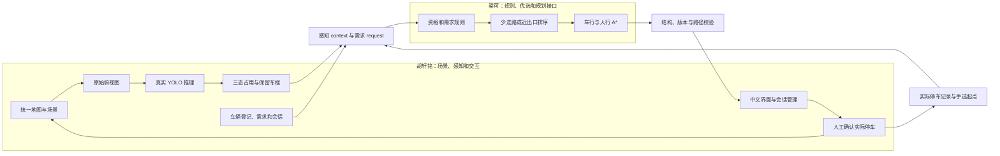

# 评分点与交付证据

本项目按选题表中的功能、创新对照和交付要求组织成果。期末展示的重点是：功能能实际运行，方法能解释，结果能追溯，双方模块能对接。具体成绩由任课教师评分，本页用于核对完成度和安排展示。

**版本边界：** 本页说明 v1.2 交付内容。当前本地 Windows EXE 已通过 13 项真实照片界面检查与 6 项停车流程检查；检测精度按独立实拍结果报告，外部召回和假空闲均有退步。公开版本以 [Releases](https://github.com/Cancery980/smart-parking-sim-real/releases/latest) 为准；[v1.1.0 原发布包](https://github.com/Cancery980/smart-parking-sim-real/releases/tag/v1.1.0) 和历史实验保留。

## 要让老师检查到什么

| 关注点 | 已有实现或证据 | 核对入口 |
| --- | --- | --- |
| 完整流程 | 申请、重规划、取消、确认实际位置、手选起点寻车、离场、重置；场景更新撤销旧路线 | [演示与答辩](课堂演示与答辩.md)、[Windows停车6项验收](../reports/windows_optimized_flow_validation.json)、[浏览器28项历史检查](../reports/ui_validation.json) |
| 实拍视觉验证 | 当前源码108张：18张PKLot开发、36张PKLot历史测试、54张CNR外部；PK两个场地/三个视角，历史跨32个日期；CNR另一场地/9相机/20日期，两组均含三天气 | [实测结果与失败案例](../reports/real_optimization/RESULTS.md)、[最终实测JSON](../reports/real_optimization/final/summary.json)、[数据来源](REAL_DATA_SOURCES.md) |
| 真实视觉计算 | 照片按钮执行YOLO；已接受检测与低置信证据分开显示，车位仍用全部≥0.20框；合成帧也调用模型，输入始终是像素 | [Windows实拍13项验收](../reports/real_photo_portable_validation.json)、[本轮外部截图](../reports/real_photo_external_ui.png)、[合成视觉](../reports/vision_report.md) |
| 对照口径可核对 | 18张开发集用于模型/阈值选择；36张做历史回归；54张外部照片未参与训练或选型；报告同时列操作门槛和共同0.20结果 | [冻结配置](../reports/real_optimization/frozen_selection.json)、[评估脚本](../scripts/evaluate_real_optimization.py)、[功能检查XML](../reports/real_optimization/functional_tests.xml) |
| 三态创新有对照 | 同一真实检测缓存、资格、障碍和路网，仅切换占用策略；30景、60个配对请求 | [I01明细与结论](../reports/i01_pairing/RESULTS.md)、[逐请求CSV](../reports/i01_pairing/paired_requests.csv) |
| 硬约束与可解释路线 | 普通/充电/无障碍条件不自动放宽；入场、出场、到电梯均检查可达性；路径距离来自路网 | [接口契约](CONTRACT_V1.md)、[规划交接](PLANNER_HANDOFF.md)、[规则测试](../tests/test_planner.py) |
| 实际停车闭环 | 实际位可与推荐位不同；记录事实后，寻车目标改为实际位外接近点 | [E06/E07记录](../reports/e2e/results.json)、[会话测试](../tests/test_sessions.py) |
| 可以交接和复跑 | JSON兼容的Python接口、外部适配器样例、指定模块的真实模型验收命令 | [梁可从这里开始](梁可从这里开始.md)、[外部模块E验收](../reports/e2e_external/results.json) |
| 工程交付与版本 | v1.2提供源码、依赖、数据、模型、许可证与报告；本地Windows EXE实际验收已完成，公开下载版本以Releases为准 | [下载与运行](../README.md)、[版本核验](../reports/交付核验.json)、[Windows重建](WINDOWS_BUILD.md) |
| 来源说得清楚 | YOLO调用Ultralytics，A*调用NetworkX，几何检查调用Shapely；本项目补充三态证据规则和停车业务 | [第三方说明](../THIRD_PARTY_NOTICES.md)、[论文核对](PAPERS.md) |

双模式与最近入口基线的路网距离对照见最终实验报告及 `reports/mode_comparison/`。它使用相同的合法可达候选集合，衡量偏好目标的取舍；随包参考适配器的结果不能代替梁可后续代码的验收。

## 两块模块怎样拼接

随包 `reference_planner.py` 提供可替换的规划参考实现，当前演示据此跑通全流程。梁可的正式实现通过同一接口接入，随后重跑契约检查、E01—E08和配对实验。图中的 `context` 不含场景真值；真值仅用于生成图像和标签、确认冲突及离线评分。

真实照片页是独立的视觉验证入口：读取实拍图与车位多边形，输出检测框和三态结果；离线占用标签不进入推理。车辆检测门槛由开发集选择，达到门槛的框计入已接受检测数；其余置信度≥0.20的框可用虚线图层显示，仍作为占用证据。占用高阈值0.50、相交比例5%保持独立，隐藏图层不会删除证据。若车位未被推理区域完整覆盖，且没有足够占用/交叠证据，则保持不确定；覆盖比例表示观测面积，不是正确率。照片页不更改停车会话，也没有把照片像素接成真实场地的米制 A* 路网。

## 结果怎样讲才准确

本次三态策略的假空位推荐率为0/58，二态为9/60；三态有2/60个请求未推荐。这个结论来自当前30个独立合成场景，同景请求不另算独立场景。应同时展示错误推荐、有效推荐和未推荐，说明可靠性与服务覆盖之间的取舍。

检测精确率与召回率在该独立合成测试集上均为100%，应标明合成域分母。真实照片另外评估：PKLot开发、训练和历史测试按日期隔离；旧36张已公开分析，单列历史回归；CNR54张在冻结后作为另一场地的外部验证。[v1.1历史结果](../reports/real_photos/RESULTS.md)保留，[新报告](../reports/real_optimization/RESULTS.md)与[实测JSON](../reports/real_optimization/final/summary.json)单独报告真实照片，不与合成图混合。

| 实拍指标 | v1.1默认门槛0.20 | 本轮门槛0.35 |
| --- | ---: | ---: |
| PK历史36张精确率 / 召回率 | 96.56% / 98.80% | 98.48% / 98.89% |
| PK假空闲次数 | 0 | 1 |
| CNR外部54张精确率 / 召回率 | 76.72% / 71.78% | 88.06% / 61.67% |
| CNR外部F1 | 74.17% | 72.54% |
| CNR假空闲次数 | 154 | 243 |

这属于已知场景及部分指标的改善；外部召回、F1与假空闲退步，不能称为全面提升。共同0.20门槛下，本轮CNR召回仍只有64.46%，低于原模型71.78%；调高车辆显示门槛不是全部原因。假空闲来自全部≥0.20证据的三态计分，与显示门槛分开。

新报告分别列默认v1.1、开发集校准v1.1和选定配置，比较各自操作门槛及共同0.20门槛；精确率或召回率下降、外部误检/漏检、unknown和假空闲均保留。Windows界面的13项检查包含6种视角的CPU真实推理并记录0个JavaScript错误，但其中CAMERA5样本0检测仍是模型失败；界面可运行不能替代精度指标。外部54张仍只覆盖另一场地的有限相机与日期，不能外推成任意停车场的部署保证。本项目未承诺或证明99.99%的检测、召回或车位正确率。

阈值是冻结的工程配置，不称为全局最优参数；项目创新点是感知不确定性与业务约束的结合及公平对照，而不是提出新YOLO网络或新A*算法。实拍中出现的漏检、过度不确定或错误空闲都要保留，解释证据和局限。

## 建议提交与展示顺序

1. 提交仓库链接、源码包和实现验证报告，让老师能追溯源码与数据。
2. 从Releases下载已核验版本，完整解压后双击ParkingDemo.exe，按[七分钟流程](课堂演示与答辩.md)先展示实拍推理，再演示停车与寻车。现场确认包内版本，再引用对应的实测记录。
3. 展示I01总表和一个跨位失败案例，再解释两种偏好与入口基线的距离取舍。
4. 展示固定接口、外部模块验收结果和双方责任表，说明后续整合位置。
5. 最后分别说明实拍视觉测试与合成导航实验的范围，展示一个实拍失败案例，回答方法来源及实验公平性问题。
