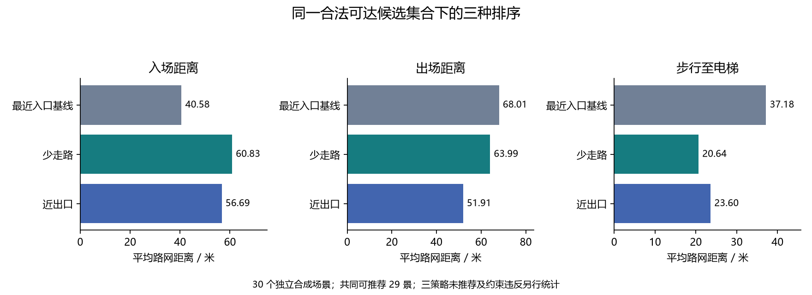

# 双模式与最近入口基线的路网对照

已有 I01 对照比较二态与三态占用，没有覆盖最近入口排序。本次补充规格书规定的距离和约束指标，复用真实 YOLO 检测缓存与三态观测空闲，使用对接参考适配器，没有改动应用核心，也不属于梁可尚未接入的代码验收。

三个策略在每个请求使用同一资格、需求、观测空闲和三条通路均可达的候选集合。最近入口定义为车行入场路网距离最小，随后按步行、出场、车位数字 ID 破除并列；距离排序前四舍五入为厘米。它不是入口欧氏直线距离。

保留 60 个既有冻结请求，每个评估三个排序，共 180 行。只有 30 个独立场景；同景两种原始偏好不计作独立样本。下表按每景一个上下文去重，三策略共同可推荐的 29 景比较平均距离，全部 30 景仍用于推荐与未推荐计数。

| 策略 | 推荐/场景 | 未推荐 | 入场均值 m | 出场均值 m | 步行均值 m | 感知规则违反数 | 真值核对违反数 |
|---|---:|---:|---:|---:|---:|---:|---:|
| 少走路 | 29/30 | 1 | 60.83 | 63.99 | 20.64 | 0 | 0 |
| 近出口 | 29/30 | 1 | 56.69 | 51.91 | 23.60 | 0 | 0 |
| 最近入口基线 | 29/30 | 1 | 40.58 | 68.01 | 37.18 | 0 | 0 |

少走路相对最近入口，平均步行距离变化 -16.54 m，入场距离变化 20.25 m。近出口相对最近入口，平均出场距离变化 -16.10 m，入场距离变化 16.10 m。负数表示距离减少，正数表示增加；各模式优化自己的目标，并非所有距离同时更短。

感知规则违反数按成功推荐中出现资格/类型不符、非观测空闲、感知障碍或路网非法的请求计数；同一请求多种问题仅记一次，并另存分项。真值核对另外统计真实占用、真实障碍不可达或资格不符，仅在决策后评分，未用真值修补推荐。

`requests.csv` 保存逐请求目标、三个距离、失败原因、候选集合哈希和各类违反；`candidate_sets.json` 可核对共享候选；`decisions.json` 保留实际路线；`summary.json` 同时给出 60 请求口径、30 场景去重口径、分组和配对变化。复跑命令为 `python scripts/compare_modes.py`。

结论只适用于当前固定路网和合成场景，不推断现实拥堵改善，不做显著性或独立泛化声明。最终与梁可模块合并后应重新运行对照。

