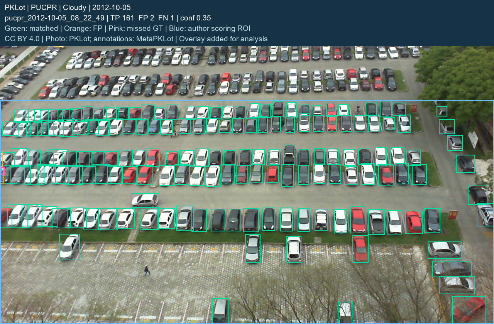
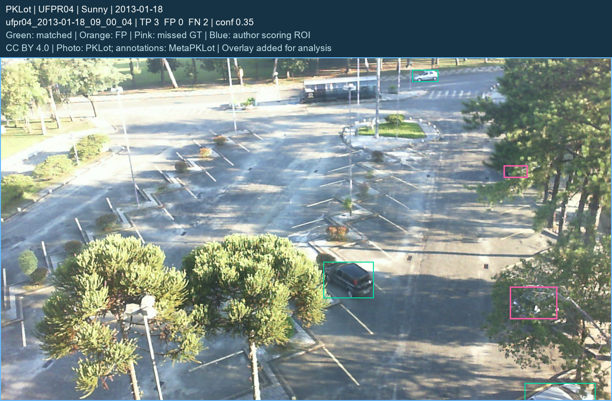
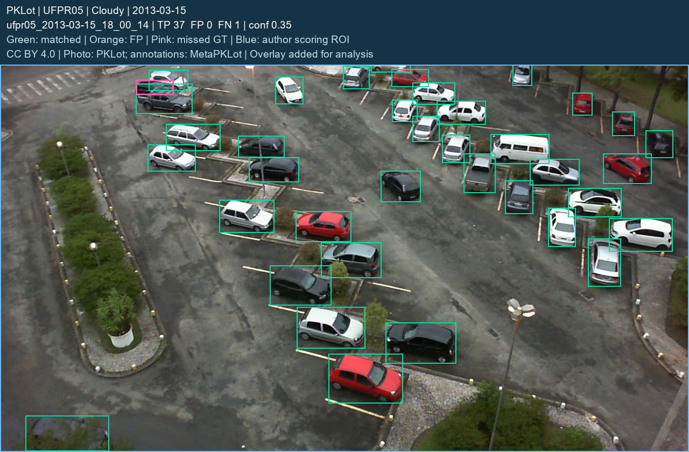
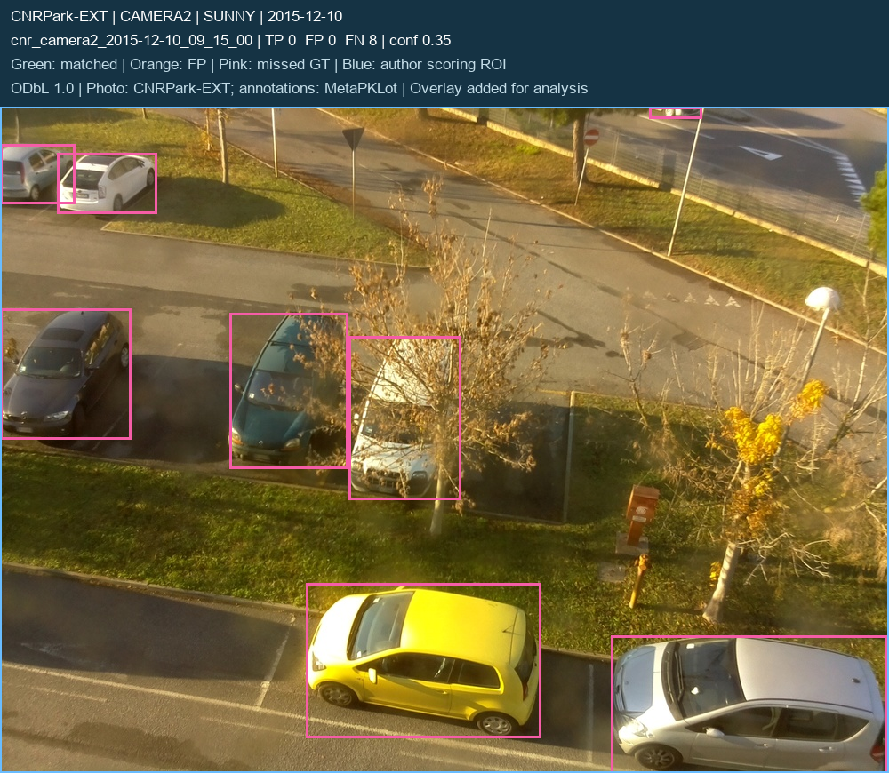
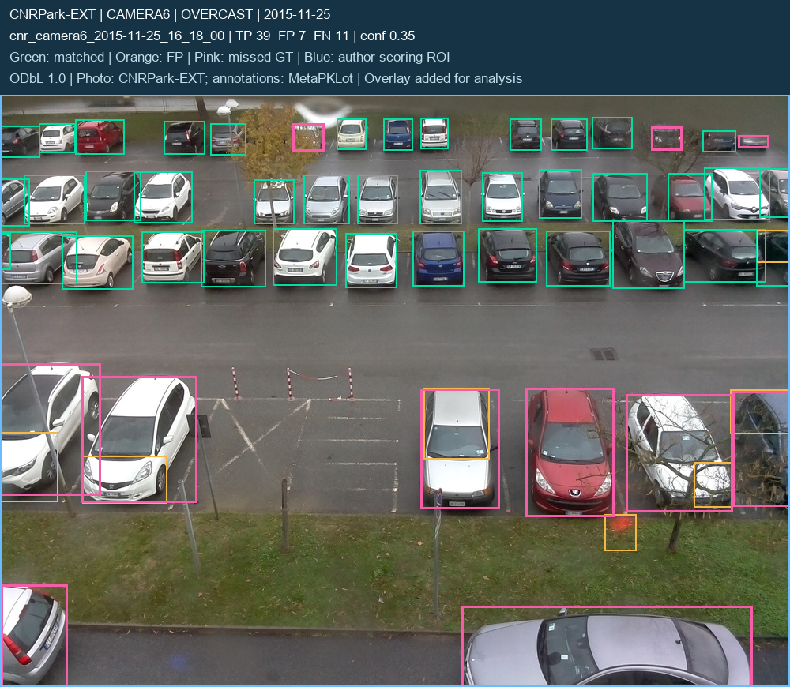

# 真实照片优化与外部验证

本报告由冻结配置后的实际预测生成。车辆检测使用车辆框真值；车位占用使用独立占用标签。两类指标分别报告，未知车位不算作正确判断。

**外部验证实测：精确率 88.06%，召回率 61.67%；FP=96，FN=440。**

## 数据角色与冻结边界

PKLot 历史回归为 36 张、32 个拍摄日期。它们在 v1.1 已公开并被分析，不能再称为本轮未见测试集。

CNRPark-EXT 外部验证为 54 张、20 个拍摄日期；本轮训练、模型选型和阈值选择均未使用这些照片。模型与阈值在评估前冻结，来源与数据哈希在冻结方案中记录。

照片张数不等于独立车辆或停车事件数；同一场地、相机或日期内仍可能相关。外部成绩只代表本次选定数据与计分范围。

实际评估时间（UTC）：`2026-11-01T12:52:53.628109+00:00`；冻结文件 SHA-256：`7ecd9e238ec8c0316c27332091ae16782f03a1add87de40d79705a66e4d2ca3f`。

[冻结选择与开发协议](frozen_selection.json) · [实际汇总JSON](final/summary.json) · [评估脚本](../../scripts/evaluate_real_optimization.py) · [报告生成脚本](../../scripts/report_real_optimization.py)

## 模型、推理设置与阈值

|配置|模型文件|输入尺寸|NMS IoU|增强推理|推理ROI|车辆检测门槛|
|---|---|---:|---:|---|---|---:|
|v1.1 原默认门槛|`models/parking_real_yolov8n.pt`|1280|0.70|否|full|0.20|
|v1.1 开发集校准门槛|`models/parking_real_yolov8n.pt`|1280|0.70|否|full|0.35|
|本轮选定配置|`models/parking_real_optimized.pt`|1280|0.70|否|calibrated|0.35|

v1.1 默认与开发集校准两项使用相同权重和推理配置，只改变可报告车辆检测的置信门槛；这一差值单独反映操作点变化。

选定配置与校准后的 v1.1 再比较，衡量候选权重及推理设置的变化；同时给出共同0.20门槛的结果，避免把调高阈值当作模型原始检测能力的全部提升。

车位占用始终使用全部置信度≥0.20的保留框，高置信占用门槛0.50、相交面积比例5%。车辆检测门槛只影响报告及“已接受检测”显示，不删除低置信占用证据。

检测指标是固定IoU≥0.50的一对一匹配 P/R/F1，不是mAP。只计作者完整标注ROI内的中心点，框裁剪到计分ROI；区域外未计分目标不直接当成误检。

## PKLot 历史回归：车辆检测

共 36 张照片。先列各配置在开发阶段选定的操作门槛：

|配置|检测门槛|TP|FP|FN|精确率|召回率|F1|
|---|---:|---:|---:|---:|---:|---:|---:|
|v1.1 原默认门槛|0.20|2134|76|26|96.56%|98.80%|97.67%|
|v1.1 开发集校准门槛|0.35|2131|52|29|97.62%|98.66%|98.13%|
|本轮选定配置|0.35|2136|33|24|98.48%|98.89%|98.68%|

相对v1.1 原默认门槛：精确率 +1.92 个百分点，召回率 +0.09 个百分点，F1 +1.02 个百分点。

相对v1.1 开发集校准门槛：精确率 +0.86 个百分点，召回率 +0.23 个百分点，F1 +0.55 个百分点。

### 共同置信门槛0.20

以下三项均在0.20计分，保留相同的作者ROI与IoU匹配规则：

|配置|检测门槛|TP|FP|FN|精确率|召回率|F1|
|---|---:|---:|---:|---:|---:|---:|---:|
|v1.1 原默认门槛|0.20|2134|76|26|96.56%|98.80%|97.67%|
|v1.1 开发集校准门槛|0.20|2134|76|26|96.56%|98.80%|97.67%|
|本轮选定配置|0.20|2141|48|19|97.81%|99.12%|98.46%|

共同0.20下相对v1.1：精确率 +1.25 个百分点，召回率 +0.32 个百分点，F1 +0.79 个百分点。

### 选定配置的视角与天气分组

|分组|TP|FP|FN|精确率|召回率|F1|
|---|---:|---:|---:|---:|---:|---:|
|Cloudy|453|8|4|98.26%|99.12%|98.69%|
|PUCPR|1011|14|2|98.63%|99.80%|99.21%|
|Rainy|861|10|10|98.85%|98.85%|98.85%|
|Sunny|822|15|10|98.21%|98.80%|98.50%|
|UFPR04|469|14|18|97.10%|96.30%|96.70%|
|UFPR05|656|5|4|99.24%|99.39%|99.32%|

设备 `cpu`；平均单图推理耗时 339.77 ms。计时含模型预处理/推理/后处理和首轮预热，不含占用几何计算；共享推理配置可能复用同一份预测，逐图记录有 `inference_reused` 标志。

## PKLot 历史回归：三态占用

|配置|车位观察数|不确定|判断覆盖率|已判定正确率|全部观察正确率|假空闲次数|假空闲 / 观测空闲|假空闲 / 真实占用|
|---|---:|---:|---:|---:|---:|---:|---:|---:|
|v1.1 原默认门槛|3326|105|96.84%|99.84%|96.69%|0|0.00%|0.00%|
|v1.1 开发集校准门槛|3326|105|96.84%|99.84%|96.69%|0|0.00%|0.00%|
|本轮选定配置|3326|109|96.72%|99.91%|96.63%|1|0.07%|0.06%|

**占用退步项：选定配置假空闲由 v1.1 的 0 次增加到 1 次。**

选定配置的完整混淆矩阵：

|真值 / 预测|观测空闲|检测占用|不确定|
|---|---:|---:|---:|
|真实空闲|1528|2|100|
|真实占用|1|1686|9|

unknown 进入总观察分母，但不计正确；“已判定正确率”只覆盖空闲/占用结论，必须同时看覆盖率和假空闲。若采用裁剪推理，未完整进入检测区域的车位在缺少明确车辆证据时保持unknown；完整照片模式不受此限制。该规则在首次外部推理前由几何检查确定，车位未从分母中删除。该结果不是实际选位推荐率，照片中没有米制路网或真实导航验收。

## CNRPark-EXT 外部验证：车辆检测

共 54 张照片。先列各配置在开发阶段选定的操作门槛：

|配置|检测门槛|TP|FP|FN|精确率|召回率|F1|
|---|---:|---:|---:|---:|---:|---:|---:|
|v1.1 原默认门槛|0.20|824|250|324|76.72%|71.78%|74.17%|
|v1.1 开发集校准门槛|0.35|795|177|353|81.79%|69.25%|75.00%|
|本轮选定配置|0.35|708|96|440|88.06%|61.67%|72.54%|

相对v1.1 原默认门槛：精确率 +11.34 个百分点，召回率 -10.10 个百分点，F1 -1.63 个百分点。

**退步项：召回率下降 10.10 个百分点；F1下降 1.63 个百分点。**

相对v1.1 开发集校准门槛：精确率 +6.27 个百分点，召回率 -7.58 个百分点，F1 -2.46 个百分点。

**退步项：召回率下降 7.58 个百分点；F1下降 2.46 个百分点。**

### 共同置信门槛0.20

以下三项均在0.20计分，保留相同的作者ROI与IoU匹配规则：

|配置|检测门槛|TP|FP|FN|精确率|召回率|F1|
|---|---:|---:|---:|---:|---:|---:|---:|
|v1.1 原默认门槛|0.20|824|250|324|76.72%|71.78%|74.17%|
|v1.1 开发集校准门槛|0.20|824|250|324|76.72%|71.78%|74.17%|
|本轮选定配置|0.20|740|140|408|84.09%|64.46%|72.98%|

共同0.20下相对v1.1：精确率 +7.37 个百分点，召回率 -7.32 个百分点，F1 -1.19 个百分点。

**共同门槛下的退步：召回率下降 7.32 个百分点；F1下降 1.19 个百分点。**

### 选定配置的视角与天气分组

|分组|TP|FP|FN|精确率|召回率|F1|
|---|---:|---:|---:|---:|---:|---:|
|CAMERA1|58|9|49|86.57%|54.21%|66.67%|
|CAMERA2|8|14|26|36.36%|23.53%|28.57%|
|CAMERA3|45|7|30|86.54%|60.00%|70.87%|
|CAMERA4|65|6|33|91.55%|66.33%|76.92%|
|CAMERA5|120|4|98|96.77%|55.05%|70.18%|
|CAMERA6|109|15|42|87.90%|72.19%|79.27%|
|CAMERA7|118|12|52|90.77%|69.41%|78.67%|
|CAMERA8|92|9|24|91.09%|79.31%|84.79%|
|CAMERA9|93|20|86|82.30%|51.96%|63.70%|
|OVERCAST|238|38|104|86.23%|69.59%|77.02%|
|RAINY|352|37|171|90.49%|67.30%|77.19%|
|SUNNY|118|21|165|84.89%|41.70%|55.92%|

设备 `cpu`；平均单图推理耗时 447.95 ms。计时含模型预处理/推理/后处理和首轮预热，不含占用几何计算；共享推理配置可能复用同一份预测，逐图记录有 `inference_reused` 标志。

## CNRPark-EXT 外部验证：三态占用

|配置|车位观察数|不确定|判断覆盖率|已判定正确率|全部观察正确率|假空闲次数|假空闲 / 观测空闲|假空闲 / 真实占用|
|---|---:|---:|---:|---:|---:|---:|---:|---:|
|v1.1 原默认门槛|2196|205|90.66%|91.61%|83.06%|154|12.76%|14.74%|
|v1.1 开发集校准门槛|2196|205|90.66%|91.61%|83.06%|154|12.76%|14.74%|
|本轮选定配置|2196|220|89.98%|87.15%|78.42%|243|18.81%|23.25%|

**占用退步项：选定配置假空闲由 v1.1 的 154 次增加到 243 次。**

选定配置的完整混淆矩阵：

|真值 / 预测|观测空闲|检测占用|不确定|
|---|---:|---:|---:|
|真实空闲|1049|11|91|
|真实占用|243|673|129|

unknown 进入总观察分母，但不计正确；“已判定正确率”只覆盖空闲/占用结论，必须同时看覆盖率和假空闲。若采用裁剪推理，未完整进入检测区域的车位在缺少明确车辆证据时保持unknown；完整照片模式不受此限制。该规则在首次外部推理前由几何检查确定，车位未从分母中删除。该结果不是实际选位推荐率，照片中没有米制路网或真实导航验收。

## 外部与历史表现的差距

选定配置在外部验证相对历史回归：精确率 -10.42 个百分点，召回率 -37.22 个百分点，F1 -26.14 个百分点。两批图像的场景和目标构成不同，这一差值用于说明观察到的迁移表现，不是控制全部因素的因果实验。

**外部下降项：精确率下降 10.42 个百分点；召回率下降 37.22 个百分点；F1下降 26.14 个百分点。**

## 保留的误差检查案例

PKLot 每个视角取最低召回的一张；CNRPark-EXT 取全集最低召回和误检最多的照片，重复时只保留一张。没有挑选最好看的成功图。若某组错误数为零，仍显示按该规则选出的样例，不虚构失败。

图中绿框为计分匹配、橙框为误检、粉框为漏检真值，蓝框为作者计分ROI。只叠加已接受且纳入计分的检测；原始JPEG未修改。未显示的低置信/区外框仍保存在逐图JSON中。

### PKLot 历史回归 / PUCPR / pucpr_2012-10-05_08_22_49

选择规则：PUCPR 视角内最低召回，平局按照片ID。

TP=161、FP=2、FN=1，检测门槛0.35。

照片：PKLot；修订标注：MetaPKLot。许可：[CC BY 4.0](https://creativecommons.org/licenses/by/4.0/)。本报告仅增加评测框和说明，未改原图文件。

[逐图预测与匹配](final/legacy_test/yolov8s_747_roi_cpu/predictions/pucpr_2012-10-05_08_22_49.json) · [上游原始照片](https://raw.githubusercontent.com/DSBD-Research/MetaPKLot-Dataset/9218800c4eb2b7c1b17b51c8cdb07ad51686f8a2/PKLot/PUCPR/Cloudy/2012-10-05/2012-10-05_08_22_49.jpg)

### PKLot 历史回归 / UFPR04 / ufpr04_2013-01-18_09_00_04

选择规则：UFPR04 视角内最低召回，平局按照片ID。

TP=3、FP=0、FN=2，检测门槛0.35。

照片：PKLot；修订标注：MetaPKLot。许可：[CC BY 4.0](https://creativecommons.org/licenses/by/4.0/)。本报告仅增加评测框和说明，未改原图文件。

[逐图预测与匹配](final/legacy_test/yolov8s_747_roi_cpu/predictions/ufpr04_2013-01-18_09_00_04.json) · [上游原始照片](https://raw.githubusercontent.com/DSBD-Research/MetaPKLot-Dataset/9218800c4eb2b7c1b17b51c8cdb07ad51686f8a2/PKLot/UFPR04/Sunny/2013-01-18/2013-01-18_09_00_04.jpg)

### PKLot 历史回归 / UFPR05 / ufpr05_2013-03-15_18_00_14

选择规则：UFPR05 视角内最低召回，平局按照片ID。

TP=37、FP=0、FN=1，检测门槛0.35。

照片：PKLot；修订标注：MetaPKLot。许可：[CC BY 4.0](https://creativecommons.org/licenses/by/4.0/)。本报告仅增加评测框和说明，未改原图文件。

[逐图预测与匹配](final/legacy_test/yolov8s_747_roi_cpu/predictions/ufpr05_2013-03-15_18_00_14.json) · [上游原始照片](https://raw.githubusercontent.com/DSBD-Research/MetaPKLot-Dataset/9218800c4eb2b7c1b17b51c8cdb07ad51686f8a2/PKLot/UFPR05/Cloudy/2013-03-15/2013-03-15_18_00_14.jpg)

### CNRPark-EXT 外部验证 / CAMERA2 / cnr_camera2_2015-12-10_09_15_00

选择规则：外部全集最低召回，平局按照片ID。

TP=0、FP=0、FN=8，检测门槛0.35。

照片：CNRPark-EXT；修订标注：MetaPKLot。许可：[ODbL 1.0](https://opendatacommons.org/licenses/odbl/1-0/)。本报告仅增加评测框和说明，未改原图文件。

[逐图预测与匹配](final/external_test/yolov8s_747_roi_cpu/predictions/cnr_camera2_2015-12-10_09_15_00.json) · [上游原始照片](https://raw.githubusercontent.com/DSBD-Research/MetaPKLot-Dataset/9218800c4eb2b7c1b17b51c8cdb07ad51686f8a2/CNRPark-EXT/camera2/SUNNY/2015-12-10/2015-12-10_09_15_00.jpg)

### CNRPark-EXT 外部验证 / CAMERA6 / cnr_camera6_2015-11-25_16_18_00

选择规则：外部全集最多误检，平局按照片ID。

TP=39、FP=7、FN=11，检测门槛0.35。

照片：CNRPark-EXT；修订标注：MetaPKLot。许可：[ODbL 1.0](https://opendatacommons.org/licenses/odbl/1-0/)。本报告仅增加评测框和说明，未改原图文件。

[逐图预测与匹配](final/external_test/yolov8s_747_roi_cpu/predictions/cnr_camera6_2015-11-25_16_18_00.json) · [上游原始照片](https://raw.githubusercontent.com/DSBD-Research/MetaPKLot-Dataset/9218800c4eb2b7c1b17b51c8cdb07ad51686f8a2/CNRPark-EXT/camera6/OVERCAST/2015-11-25/2015-11-25_16_18_00.jpg)

## 来源、许可与复现

- PKLot 照片与相应数据组件：Paulo de Almeida 等；[CC BY 4.0](https://creativecommons.org/licenses/by/4.0/)。
- CNRPark-EXT 照片与相应数据组件：Giuseppe Amato、Fabio Carrara 等；[ODbL 1.0](https://opendatacommons.org/licenses/odbl/1-0/)。两种数据许可分别适用，不能把整个数据包统一改写为项目源码许可。
- 修订车辆与车位标注来自 [MetaPKLot 作者仓库](https://github.com/DSBD-Research/MetaPKLot-Dataset)。具体来源、变更及数据署名以各数据目录文件为准。

[来源核对](../../docs/REAL_DATA_SOURCES.md) · [项目第三方说明](../../THIRD_PARTY_NOTICES.md)

仅重建本报告：`python scripts/report_real_optimization.py`。重新评估会执行真实推理，必须指定新的输出目录，例如 `python scripts/evaluate_real_optimization.py --device cpu --output reports/real_optimization/rerun`，保留现有证据。随后用 `--summary` 指向新汇总，`--selection` 指向对应冻结文件。

修改模型或阈值后，旧结果不再代表新配置。开发集校准结果与历史回归都不代替未参与选型的外部验证；保留所有失败与低于预期的结果。
