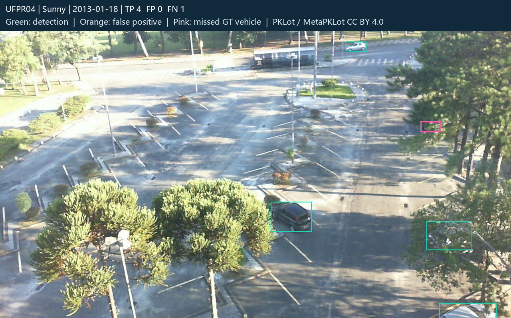
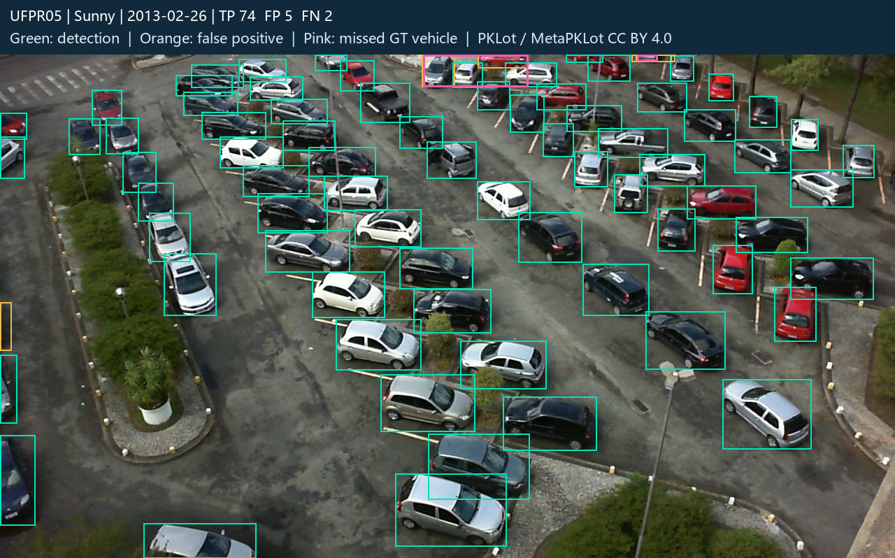
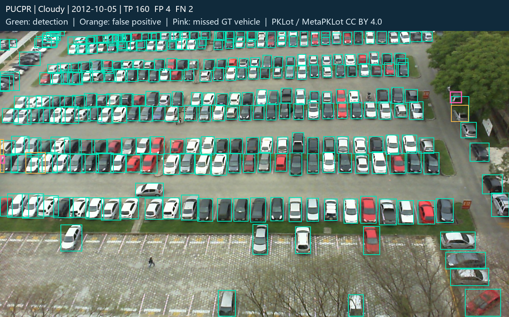

# 真实停车场照片实验

照片来自 PKLot 的两个物理停车场、三个拍摄视角，覆盖晴天、多云、雨天；车辆与修订车位标注来自 MetaPKLot。图像保持原始字节，抽样在推理前固定。

## 划分与选型

18 张开发照片用于选模型，36 张测试照片涉及 32 个拍摄日期。不同照片不等于独立停车事件。训练、开发和测试按整个拍摄日期隔离，仍共享相机场景，不能称为未知停车场泛化。

通用模型在开发集召回率约 61%，因此增加 270 张其他日期的真实训练照片；所有候选与微调检查点都只由开发集选择。基线和新模型在同一测试集比较；测试结果不参与权重或阈值选择。训练图通过脚本下载，来源与哈希见 training_manifest.json。

## 车辆检测

置信度 ≥0.20，车辆框 IoU ≥0.50，一对一匹配；这是固定阈值精确率/召回率/F1，不是 mAP。只评作者标注完整 ROI 内中心点，预测与真值框裁到该 ROI；不把标注区外车辆计作误检。

|模型|TP|FP|FN|精确率|召回率|F1|
|---|---:|---:|---:|---:|---:|---:|
|原合成域模型|504|952|1656|34.62%|23.33%|27.88%|
|通用COCO模型|1277|113|883|91.87%|59.12%|71.94%|
|交付真实照片模型|2134|76|26|96.56%|98.80%|97.67%|

## 车位占用

|真值 / 预测|空闲|占用|不确定|
|---|---:|---:|---:|
|真实空闲|1530|5|95|
|真实占用|0|1686|10|

共 3326 次车位观察，不确定 105 次；覆盖率（给出空闲/占用结论）96.84%，已判定部分正确率 99.84%，全部观察正确率 96.69%。

实际占用却判为空闲 0 次，占所有“观测空闲” 0.00%，占全部真实占用 0.00%。不能把车辆检测精确率当作车位判定准确率，也不能把未知状态计作正确。

沿用高/低置信度 0.50/0.20、相交面积比例 5%。真实照片按标定多边形及原始像素处理。透视、遮挡和检测框中心偏移仍会造成错误；照片模块验证视觉，不生成未经米制标定的真实场地导航。

## 失败案例与复现

每个视角保留召回率最低的测试照片；全部逐图预测与错误计数都在 test/ 下，未删除失败。

### UFPR04 低召回案例

照片 `ufpr04_2013-01-18_09_00_04`，TP=4、FP=0、FN=1。

### UFPR05 低召回案例

照片 `ufpr05_2013-02-26_15_19_36`，TP=74、FP=5、FN=2。

### PUCPR 低召回案例

照片 `pucpr_2012-10-05_08_22_49`，TP=160、FP=4、FN=2。

车辆框来源与车位标签严格分离。运行时只读无状态几何清单，不读 annotations.json；后者仅供离线计分。

复现：先备份 reports/real_photos，再执行 `python scripts/evaluate_real_photos.py --stage test --device cpu --rerun`，对三个模型重新执行实际推理；不加 --rerun 时复用已核验权重的缓存。重新训练见 `python scripts/train_real_photos.py --help`。

来源、许可及变更：[数据署名](../../data/real/ATTRIBUTION.md)、[原作者与开源核对](../../docs/REAL_DATA_SOURCES.md)。模型参数、哈希、每图输出和开发集选择依据在同目录 JSON。
