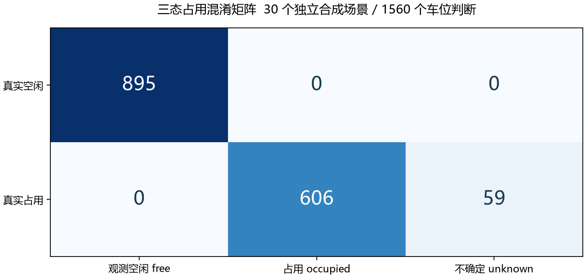

# 胡轩铭模块视觉实验报告

本报告记录可运行的 YOLO 车辆检测、三态占用与离线评测。实验对象为项目自制二维俯视仿真图。模型只从图像预测车辆框，规划读取预测占用；场景实体和占用真值仅用于渲染、标注、确认冲突检查与离线评分。

## 开源复用与素材

复用 [Ultralytics 8.3.235](https://github.com/ultralytics/ultralytics/tree/v8.3.235) 的 YOLOv8n 训练和预测。已有权重来自[官方发布文件](https://github.com/ultralytics/assets/releases/download/v8.3.0/yolov8n.pt)，许可证原文随 models/ULTRALYTICS_LICENSE 提供。车体、道路和标线由 parking_hu/scenes.py 用 Pillow 绘制，没有使用来源不明的图片。三种车身细节、多种配色、朝向和尺寸属于同一程序化合成图域。

24 张探索图中有 21 张唯一图像；4 张空场图对应相同固定底图。已有 COCO 权重在 514 个车辆实例上未检出车辆，召回率为 0；精确率因无预测记 N/A。这一失败记录保留在 vision_pretrained_exploration.json。探索中的真实被占车位被判为观测空闲共 538 次，因此直接使用该权重无法支撑项目。随后采用独立训练和验证数据对仿真图域进行微调。

## 数据与冻结

训练集 180 张图像，其中 169 张唯一图像，重复仅为训练负样本空场；验证集 30 个不同场景；最终测试 30 个不同场景，按生成条件预先分为常规停车、局部人工遮挡、边界或跨位各 10 景。三组划分的图像 SHA256 交集均为空。测试共有 607 个车辆实例，产生 1560 次车位状态判断；这些判断并非 1560 个独立场景。

frozen_design.json 在推理前保存种子及场景分组。最终测试不参与微调、阈值选择或最佳权重选择；最佳检查点仅按验证集选择。训练含横向阻挡车辆和人工遮挡，运行时仍由模型检测，不把配置坐标直接作为检测输出。人工遮挡是预先定义的顶部局部掩膜，不等同真实复杂遮挡。

## 模型与口径

使用 Python 3.12、Torch 2.5.1+cu124、Ultralytics 8.3.235，训练种子 20261031，网络输入尺寸 832，批量 8，上限 35 轮，实际完成 35 轮。完整参数与每轮结果分别见 vision_training_config.json、vision_training_results.csv。模型输出坐标由 Ultralytics 还原到 1664×1024 原图后除以 32 转为米。

保留阈值 0.20、高阈值 0.50、车位相交面积比阈值 5% 在测试前冻结。检测精确率与召回率按同一类别、IoU 不低于 0.50 的一对一匹配统计；下表不是 mAP。高置信框中心严格位于车位内部才判占用；保留框的模糊相交使车位成为不确定；明确占用优先。整帧失效时全场不确定，禁止沿用旧占用。

## 实测结果

| 范围 | TP | FP | FN | 精确率 | 召回率 |
|---|---:|---:|---:|---:|---:|
| 已有权重探索 24 张 | 0 | 0 | 514 | N/A | 0.00% |
| 最终测试 保留阈值 0.20 | 607 | 0 | 0 | 100.00% | 100.00% |
| 最终测试 高阈值 0.50 | 607 | 0 | 0 | 100.00% | 100.00% |
| 常规停车 10 景 | 191 | 0 | 0 | 100.00% | 100.00% |
| 人工局部遮挡 10 景 | 213 | 0 | 0 | 100.00% | 100.00% |
| 边界或跨位 10 景 | 203 | 0 | 0 | 100.00% | 100.00% |

| 真值 | 观测空闲 | 占用 | 不确定 |
|---|---:|---:|---:|
| 真实空闲 | 895 | 0 | 0 |
| 真实占用 | 0 | 606 | 59 |

测试中真实被占但判为观测空闲的车位判断共 0 次，不确定判断共 59 次。逐场景明细见 vision_per_scene.csv，真实检测缓存与独立真值分别保存在 data/detection_cache 的 snapshot 和 truth 字段。vision_cases 保存每组示例以及检出错误或假空闲案例；没有错误时仍保留组别示例，不捏造失败图。

## 对接与局限

梁可的规划模块只接收 map、snapshot、登记车辆和会话摘要。snapshot.obstacles_m 包含本帧所有置信度不低于 0.20 的车辆框，包括未落入车位的框。二态离线比较与三态共用这些障碍；两组唯一差异为占用判定。30 景检测缓存可供 I01 的 60 个配对请求重复使用。

这些结果只支持同一程序化素材、同一地图和独立种子的仿真场景。它们没有验证实拍摄像头、真实地库光照、严重遮挡或新车型的泛化。不确定状态只能利用已检出的模糊证据，无法发现完全漏检的车辆。最终系统的会话、8 个真实模型端到端案例和参考规划配对结果见项目总验收报告，不能由本视觉结果替代。

## 复现文件

已有交付模型可直接运行 scripts/vision_evaluate.py 重新评测固定测试图。重建训练数据使用 scripts/vision_prepare.py，训练使用 scripts/vision_train.py；需按项目 setup.ps1 配置 Python 3.12 环境。重新训练可能因设备和库实现差异产生数值变化，应保留新权重和新结果，不能继续引用原模型成绩。

最终权重 SHA256：`0f515f2bb6efce456b72d63d8c4513382165c6bf4533b79a9906b49554aa4c05`

测试清单 SHA256：`d78304c7601c8642353359c26211953c49b4a77e68d5b960ffc0c73ed3ef6e69`
